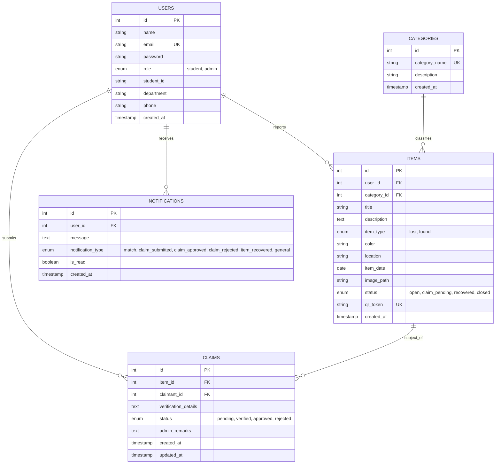

# CampusFind 2.0 - Database Design & Architecture

> **B.Tech Computer Science and Engineering &bull; Web Technology Project-Based Learning (PBL)**

---

## 1. Entity-Relationship (ER) Diagram



---

## 2. Relational Schema & Cardinality Details

1. **`USERS` &rarr; `ITEMS` (1 : N)**
   - One user (student or staff) can report zero, one, or multiple lost or found items.
   - `items.user_id` references `users.id` with `ON DELETE CASCADE`.
2. **`CATEGORIES` &rarr; `ITEMS` (1 : N)**
   - A standardized category classifies multiple reported items.
   - `items.category_id` references `categories.id` with `ON DELETE SET NULL`.
3. **`ITEMS` &rarr; `CLAIMS` (1 : N)**
   - An item (specifically a found belonging) may receive ownership claims from claimants.
   - `claims.item_id` references `items.id` with `ON DELETE CASCADE`.
4. **`USERS` &rarr; `CLAIMS` (1 : N)**
   - A student (`claimant_id`) submits verification claims for their lost items.
   - `claims.claimant_id` references `users.id` with `ON DELETE CASCADE`.
5. **`USERS` &rarr; `NOTIFICATIONS` (1 : N)**
   - Users receive system notifications regarding match alerts and claim resolutions.
   - `notifications.user_id` references `users.id` with `ON DELETE CASCADE`.

---

## 3. Database Normalization (3NF Justification)

CampusFind 2.0 satisfies **Third Normal Form (3NF)**:
- **1NF**: All table columns hold atomic, scalar values (no repeating groups, comma-separated lists, or nested objects).
- **2NF**: All non-key attributes are fully functionally dependent on the entire primary key (`id`).
- **3NF**: There are no transitive dependencies; non-key attributes depend only on the primary key (e.g., category names are stored in `categories` rather than repeating strings in `items`).

---

## 4. Database Connection Procedure (Connection Pooling)

Connection pooling is implemented using `mysql2/promise` in `backend/config/db.js`:

```javascript
const mysql = require('mysql2');
const pool = mysql.createPool({
  host: process.env.DB_HOST,
  user: process.env.DB_USER,
  password: process.env.DB_PASSWORD,
  database: process.env.DB_NAME,
  port: process.env.DB_PORT,
  waitForConnections: true,
  connectionLimit: 10,
  queueLimit: 0
});
const db = pool.promise();
```

### Advantages of Connection Pooling:
- Avoids the overhead of establishing a new TCP handshake on every incoming HTTP request.
- Manages connection lifecycle gracefully under high campus traffic.
- Transparently recycles idle connections with `enableKeepAlive: true`.

